# 🛡️ Escudo de Llamadas (Filtro400)

Aplicación Android, escrita en **Kotlin** con **Jetpack Compose** y **Material 3**, que **bloquea automáticamente las llamadas entrantes** cuyo número empieza por un prefijo configurado (por defecto, **400**) usando las funcionalidades nativas de Android: `CallScreeningService` y el rol `ROLE_CALL_SCREENING`. No sustituye a la aplicación de teléfono y no necesita servidor ni conexión a Internet.

> Autor: **Daniel Baeza** ([@Chacal231](https://github.com/Chacal231/pmdm-udit/tree/main/reto03-filtro400)) · 2º DAM · PMDM · UDIT

## 🎥 Vídeo de demostración

👉 [Ver el vídeo (OneDrive, máx. 3 min)](PEGA_AQUI_EL_ENLACE_DE_ONEDRIVE)

## 📸 Capturas

### Primer arranque y activación del filtro

| Introducción | Filtro inactivo | Solicitud del rol | Filtro activo |
|---|---|---|---|
| 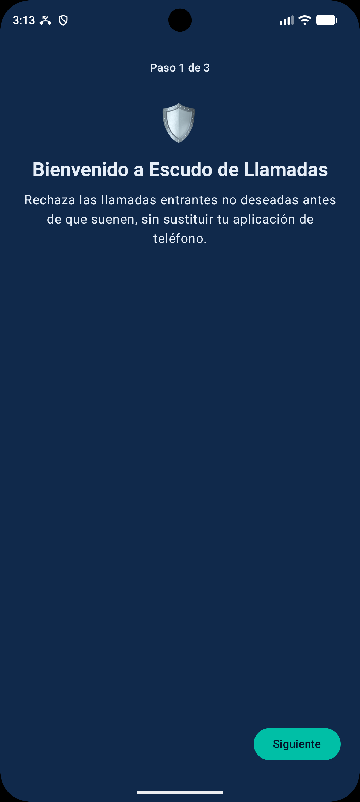 | 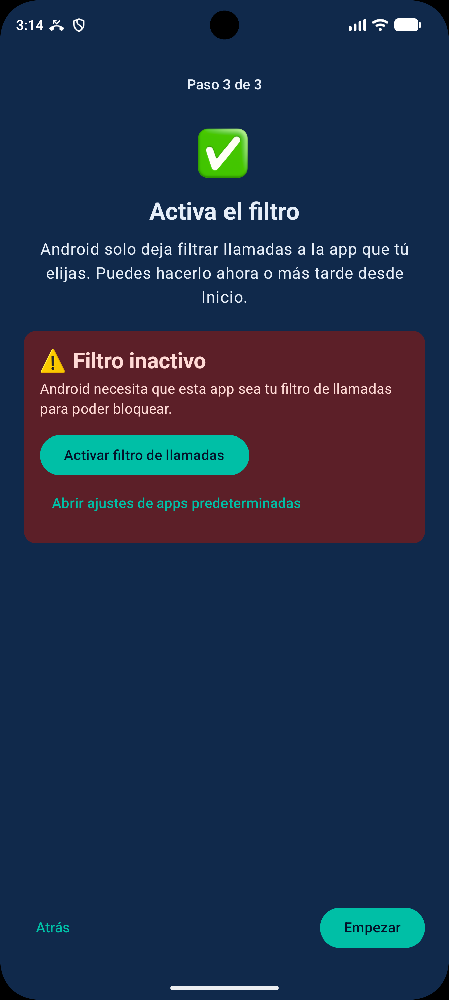 | 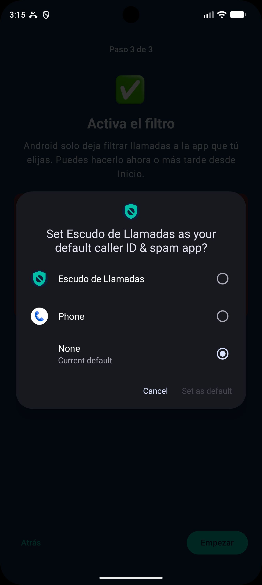 | 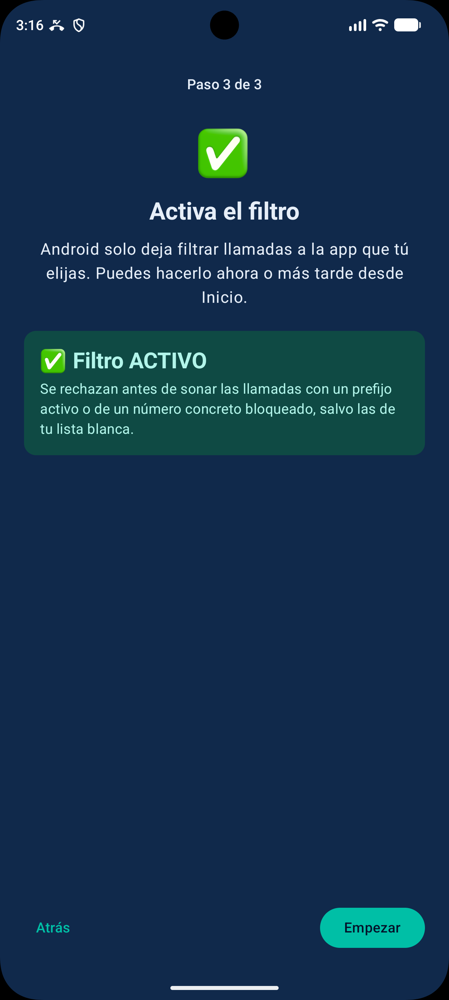 |

### Uso de la aplicación

| Probador | Reglas | Contador | Actividad |
|---|---|---|---|
| 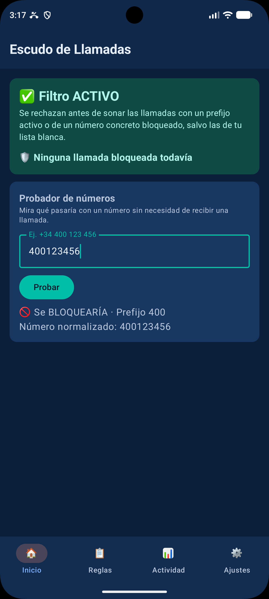 | 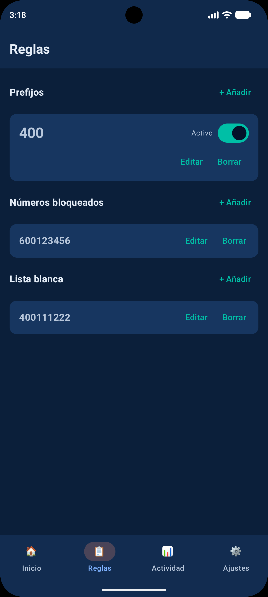 | 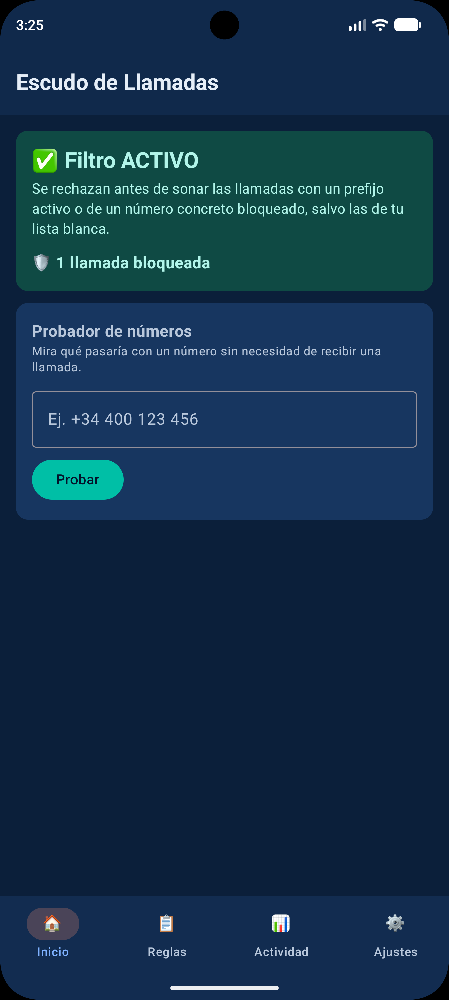 | 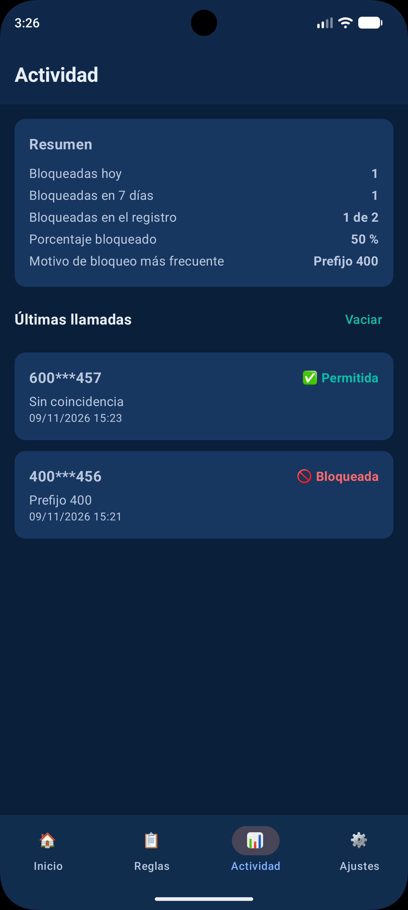 |

### Ajustes, tema y datos de la app

| Ajustes y tema | Modo oscuro | Acerca de |
|---|---|---|
| 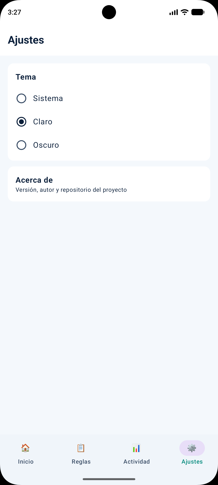 | 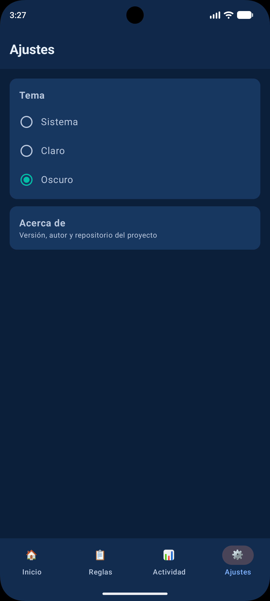 | 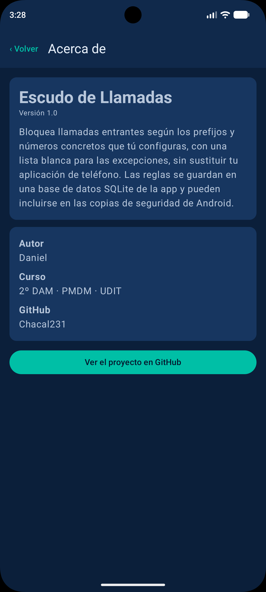 |

## ✅ Qué hace la aplicación

**Requisitos del reto**

- Solicita al usuario el rol de filtrado de llamadas (`ROLE_CALL_SCREENING`) mediante el diálogo del sistema.
- Detecta las llamadas entrantes que Android entrega al servicio.
- Identifica los números que empiezan por **400**, contemplando los formatos españoles `+34` y `0034` (y espacios o guiones).
- Rechaza automáticamente las llamadas que cumplen la regla, sin que lleguen a sonar.
- Deja pasar el resto de llamadas con normalidad.
- Interfaz para activar el filtro y **probar números** sin recibir una llamada.
- **Pruebas unitarias** de la lógica de filtrado.

**Mejoras añadidas**

- **Prefijos configurables**: añadir, editar, borrar y activar/desactivar, guardados en **SQLite** (el 400 viene creado de serie).
- **Lista blanca**: números que nunca se bloquean, con prioridad sobre el resto de reglas.
- **Números concretos**: bloqueo de un número exacto, además de prefijos.
- **Registro de actividad** con el número **enmascarado**, la decisión y el motivo, y **resumen estadístico** (bloqueadas hoy, últimos 7 días, porcentaje y motivo más frecuente).
- **Contador** de llamadas bloqueadas en la pantalla principal, actualizado en directo.
- **Navegación inferior** con cuatro secciones: Inicio, Reglas, Actividad y Ajustes.
- **Introducción de 3 pasos** la primera vez que se abre la aplicación.
- **Selector de tema** Sistema / Claro / Oscuro, con paleta propia en los dos modos, y icono propio.
- Confirmación antes de borrar, con opción de **Deshacer**.
- El probador indica **qué regla** provoca el bloqueo y usa el mismo motor de decisión que el servicio real.
- El estado del filtro se actualiza solo al volver a la app, con acceso a los ajustes de apps predeterminadas.
- Los cambios se aplican al instante: el servicio consulta la base de datos en cada llamada.
- **Privacidad**: el número completo no se escribe nunca en Logcat ni en el registro de actividad.

## 🧠 Cómo funciona

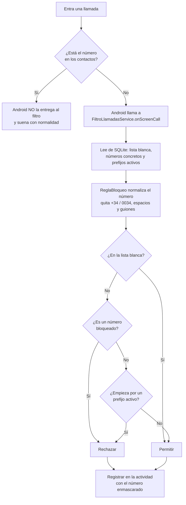

El orden de decisión es siempre: **lista blanca → número concreto → prefijo → permitir**.

### Estructura del proyecto

```
app/src/main/java/com/example/filtro400/
├── MainActivity.kt           # Interfaz (Compose): raíz, navegación, Inicio, Reglas
├── FiltroLlamadasService.kt  # CallScreeningService: decide sobre cada llamada
├── ReglaBloqueo.kt           # Lógica pura: normalizar, decidir y enmascarar
├── Actividad.kt              # Lógica pura: entradas del registro, siempre enmascaradas
├── EstadisticasActividad.kt  # Lógica pura: resumen del registro
├── ContadorBloqueos.kt       # Lógica pura: texto del contador
├── FiltrosDbHelper.kt        # SQLite (v2): filtros, números y actividad
├── Filtro.kt / NumeroRegla.kt# Modelos de datos
├── Preferencias.kt           # SharedPreferences: tema, introducción y contador
├── Seccion.kt                # Secciones de la navegación inferior
├── PantallaActividad.kt      # Registro y resumen
├── PantallaAjustes.kt        # Selector de tema y acceso a Acerca de
├── PantallaOnboarding.kt     # Introducción de 3 pasos
└── ui/theme/                 # Tema claro/oscuro, ModoTema y tipografía
app/src/test/.../             # Pruebas unitarias (73)
```

### Decisiones técnicas

- **Lógica separada de Android.** `ReglaBloqueo`, `Actividad`, `EstadisticasActividad` y `ContadorBloqueos` son código puro, sin clases de Android: se prueban con tests unitarios en la JVM, sin emulador. El servicio solo consulta los datos y aplica la decisión.
- **Un único motor de decisión.** El servicio real y el probador usan la misma función `decidir`, para que el probador nunca contradiga lo que hace una llamada real.
- **Normalización antes de comparar.** Un mismo número puede llegar como `400123456`, `+34400123456` o `0034 400 123 456`. Se deja siempre en un único formato, y los prefijos que escribe el usuario se limpian igual.
- **SQLite con `SQLiteOpenHelper`**, tal y como pedía el reto, sin Room. La base de datos pasó a la **versión 2** con un `onUpgrade` que solo **añade** tablas (`numeros` y `actividad`) y conserva los datos de la tabla `filtros`.
- **Lectura de la base de datos en cada llamada.** Un filtro modificado o desactivado surte efecto inmediato, sin reiniciar el servicio.
- **El servicio nunca falla a ciegas.** La decisión, el contador y el registro van cada uno protegidos: si algo falla, **la llamada se permite** y siempre se responde a Android.
- **Privacidad por diseño.** El registro solo puede recibir números ya enmascarados (`400***456`), y los prefijos largos solo muestran sus tres primeras cifras. Las tablas de reglas sí guardan números completos porque hacen falta para comparar: son configuración, no registro, y nunca van a Logcat.
- **Registro acotado.** Solo se conservan las 500 entradas más recientes.
- **Preferencias sencillas en `SharedPreferences`** para el tema, la introducción y el contador, sin necesidad de migraciones.
- **Compose sin librerías extra.** La navegación se resuelve con un estado y `NavigationBar` de Material 3; el estado del rol se refresca en `onResume`.
- **Números ocultos no se bloquean.** Si Android no entrega número, la regla no puede decidir, por lo que la llamada continúa.

## 🧪 Pruebas

### Pruebas unitarias (73)

| Suite | Pruebas | Qué cubre |
|---|---|---|
| `ReglaBloqueoTest` | 16 | `+34`, `0034`, espacios y guiones, número vacío u oculto, varios prefijos, limpieza de prefijos, prefijo coincidente y enmascarado |
| `DecisionLlamadaTest` | 20 | Orden de decisión, prioridades, formatos y validación de números |
| `EstadisticasActividadTest` | 15 | Registro vacío, límite de medianoche, ventana de 7 días y empates |
| `ActividadTest` | 11 | Enmascarado, motivos y que ningún dato revele el número completo |
| `ModoTemaTest` | 6 | Selección del tema |
| `ContadorBloqueosTest` | 4 | Textos en singular y plural |
| `ExampleUnitTest` | 1 | Plantilla de Android Studio |

Para ejecutarlas: clic derecho sobre `app/src/test` → **Run Tests**, o `./gradlew testDebugUnitTest`.

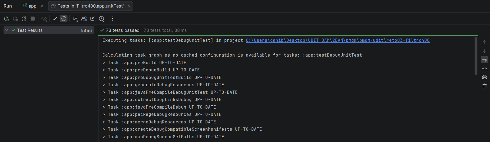

### Pruebas con llamadas reales (emulador)

Probado en un **emulador de Android Studio (Pixel 8 Pro, API 37)**. Las llamadas se simulan desde *Extended controls → Phone*. El número no debe estar en los contactos. En Logcat se filtra por la etiqueta `Filtro400`.

| Prueba | Resultado esperado | Evidencia |
|---|---|---|
| Llamada desde `400123456` | Rechazada, no suena. Logcat: `Llamada de 400***456 -> BLOQUEADA` | 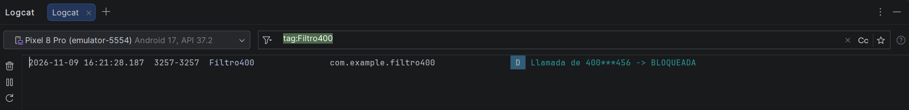 |
| Llamada desde `+34400123457` | Rechazada (formato `+34`) | Vídeo |
| Llamada desde `600123457` | Permitida, suena con normalidad. Logcat: `Llamada de 600***457 -> PERMITIDA` | 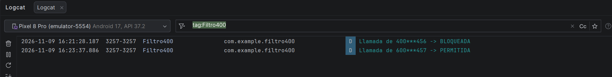 |
| Desactivar el prefijo 400 y repetir | La llamada deja de bloquearse | Vídeo |
| Número en la lista blanca | Pasa aunque empiece por un prefijo bloqueado | Vídeo |

## ⚙️ Cómo compilarlo y usarlo

**Requisitos:** Android Studio, JDK 11 o superior y un dispositivo o emulador con **Android 10 (API 29) o superior**.

1. Clona el repositorio y abre la carpeta `reto03-filtro400` en Android Studio.
2. Espera a que termine la sincronización de Gradle y pulsa **Run**.
3. Sigue la introducción y, en el último paso (o desde Inicio), pulsa **Activar filtro de llamadas** y acepta el diálogo del sistema.
4. Añade o activa los prefijos, números y lista blanca que quieras desde la pestaña **Reglas**.

También puedes descargar el APK desde la sección **Releases** del repositorio.

## ⚠️ Limitaciones

- Android **no entrega al filtro las llamadas de números guardados en los contactos**; esas llamadas tampoco aparecen en el registro de actividad.
- Android puede limitar qué llamadas llegan al servicio según el dispositivo y la versión: no se debe asumir que se reciben todas.
- Los números ocultos no se bloquean.
- Los prefijos o números extranjeros solo coinciden si se escriben en el mismo formato en que llegan: la normalización solo cubre los formatos españoles (`+34` y `0034`).
- La copia de seguridad automática de Android está activa, por lo que las reglas podrían incluirse en ella.
- Las estadísticas parten del registro: se reinician al vaciarlo y cubren, como mucho, las últimas 500 entradas.
- Requiere Android 10 o superior (`minSdk` 29).

## 🛠️ Dificultades encontradas

- **El rol no se puede conceder por código.** Android obliga a mostrar su propio diálogo, así que hay que lanzar la petición y volver a comprobar el estado al regresar.
- **Probar con llamadas reales.** Hay que usar números que no estén en los contactos, porque en ese caso el sistema no consulta al filtro.
- **Los iconos de Compose no se resolvían** en el proyecto, así que los botones de editar y borrar y la navegación usan texto y emojis.
- **Migrar la base de datos sin perder datos.** Se creó la versión 2 de una sola vez, con todas las tablas nuevas, y se probó instalando encima de la versión anterior.
- **Privacidad en los registros.** El primer prototipo escribía el número completo en Logcat; se sustituyó por una versión enmascarada. Más adelante, una revisión del código detectó que un prefijo largo mostrado junto al número enmascarado podía revelarlo entero, y se corrigió mostrando solo las tres primeras cifras del prefijo.
- **Archivos del IDE en Git.** La carpeta `.idea` se había subido y generaba cambios continuos; se dejó de versionar.

## 📝 Reflexión crítica

**1. ¿Qué es `CallScreeningService` y qué función cumple en Android?**
Es un servicio del sistema (paquete `android.telecom`) al que Android avisa de cada llamada entrante antes de que suene, entregándole los detalles de la llamada (`Call.Details`), entre ellos el número. La app responde con un `CallResponse` que indica qué hacer: permitirla, rechazarla, silenciarla o no dejar rastro en el registro o las notificaciones. Permite filtrar llamadas sin sustituir la aplicación de teléfono.

**2. ¿Por qué necesitamos solicitar el rol `ROLE_CALL_SCREENING`?**
Porque filtrar llamadas da acceso a información sensible: los números de quien llama y la capacidad de impedir que suene el teléfono. Desde Android 10, el sistema solo vincula un servicio de filtrado si el usuario ha concedido de forma explícita ese rol a la app, mediante un diálogo propio de Android. Sin el rol, el sistema no llama a nuestro servicio. Solo una app puede tener el rol a la vez.

**3. ¿Por qué no necesitamos un servidor externo para realizar el filtrado?**
Porque toda la información necesaria está en el propio móvil: Android entrega el número al servicio y las reglas (prefijos, números y lista blanca) se guardan en una base de datos SQLite local. La decisión es una simple comparación de texto que se resuelve en milisegundos. Además, consultar un servidor añadiría latencia (el sistema espera la respuesta un tiempo limitado), exigiría conexión a Internet y enviaría los números de quien llama a un tercero, lo que sería un problema de privacidad.

**4. ¿Qué ocurre si el número telefónico está guardado en los contactos?**
Android no consulta al servicio de filtrado por las llamadas de números que están en los contactos del usuario, por lo que la llamada suena con normalidad aunque empiece por 400. Por eso, para probar la app, hay que llamar desde números que no estén guardados.

**5. ¿Qué diferencias existen entre comprobar un número mediante una función y bloquear realmente una llamada?**
Una función como `ReglaBloqueo.decidir` solo decide sobre un texto: es lógica pura, sin efectos y fácil de probar con tests unitarios. Bloquear una llamada real depende además del sistema operativo: que el usuario haya concedido el rol, que Android vincule el servicio, que entregue esa llamada (no lo hace con los contactos ni siempre con los números ocultos) y que la respuesta llegue a tiempo. Que el probador diga "se bloquearía" no garantiza que el bloqueo ocurra. Por eso el proyecto separa la regla (probada con tests y compartida por el probador y el servicio) de la ejecución real (probada con llamadas simuladas en el emulador y en el vídeo).

**6. ¿Qué mejoras incorporarías en una futura versión?**
Ya se han incorporado la **lista blanca**, el **bloqueo de números concretos**, el **registro de actividad** con número enmascarado y unas **estadísticas** básicas. Quedarían por hacer:
- **Importar y exportar** las reglas en CSV.
- **Bloqueo por franjas horarias** y una opción para números ocultos.
- Un **gráfico** de llamadas bloqueadas por día.
- Normalización de **prefijos internacionales** de otros países.
- Consulta de **bases de datos antispam** externas, valorando la privacidad.
- Mejorar la arquitectura con un repositorio y `ViewModel`, valorar Room y añadir integración continua con GitHub Actions.

## 📄 Licencia

Proyecto académico del ciclo DAM. Uso educativo.