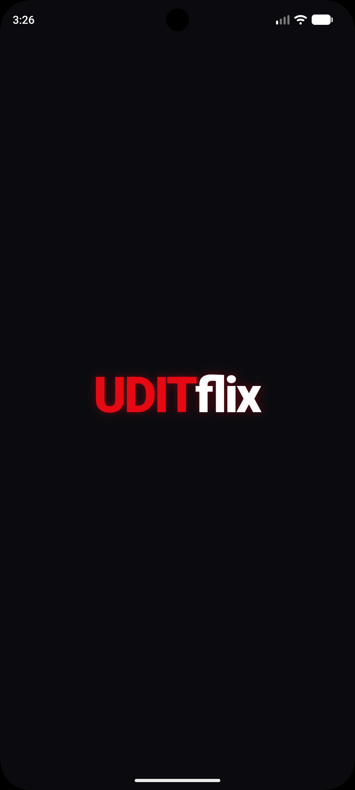
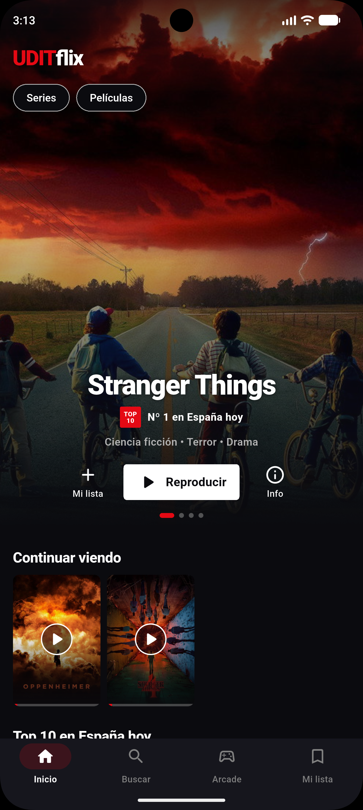
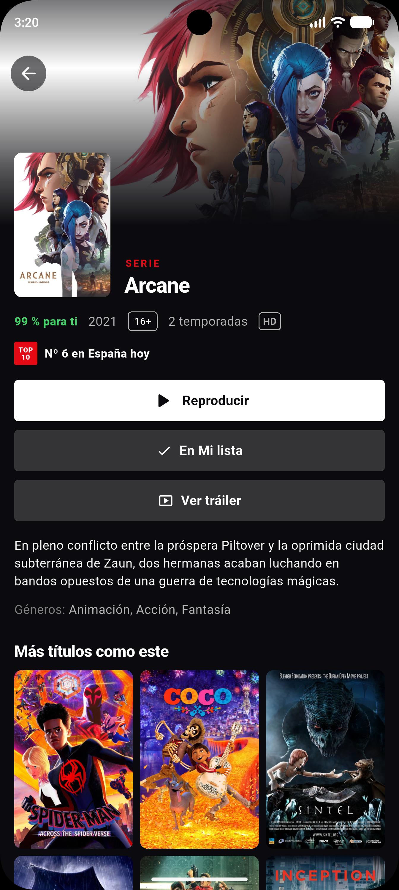
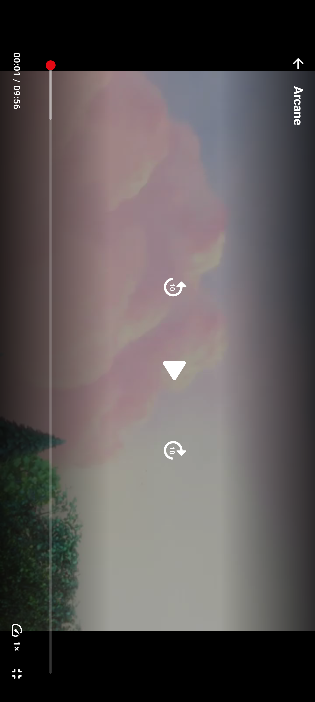
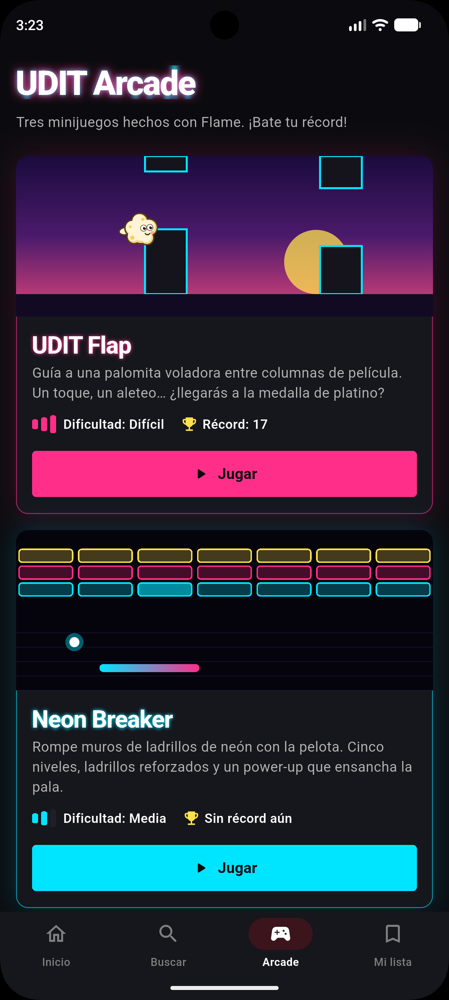
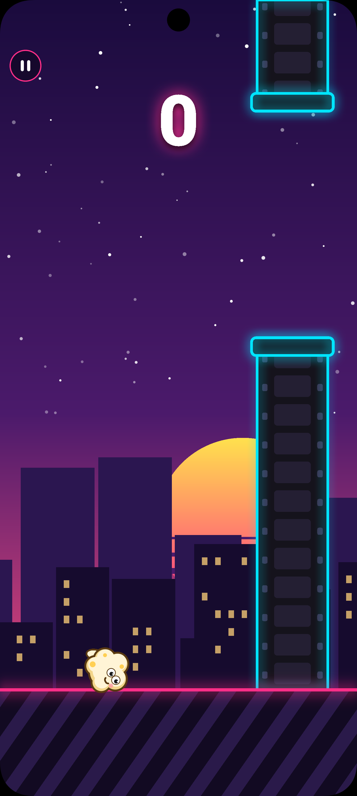
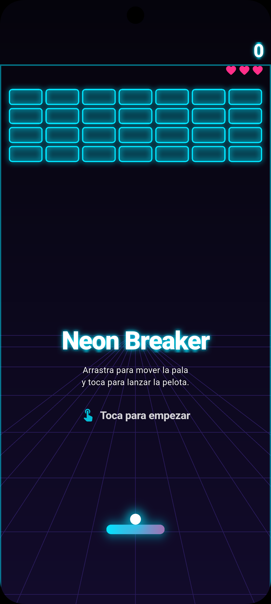
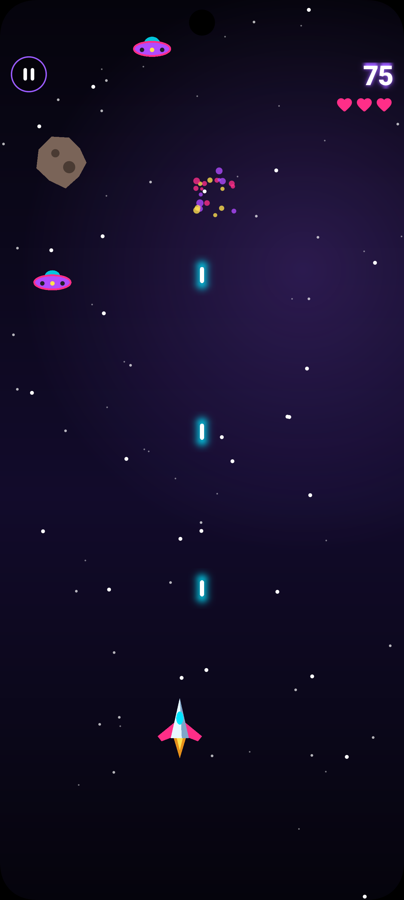

# UDITflix

App de streaming hecha con Flutter, inspirada en las grandes plataformas pero con identidad propia. Incluye:
- un catálogo con títulos reales;
- un reproductor de vídeo con controles propios;
- tráileres oficiales de YouTube;
- **UDIT Arcade**, una sección con tres minijuegos hechos con Flame.

Proyecto de la asignatura PMDM (2.º DAM, UDIT). Funciona en **Android** y en **web**.

---

## Capturas

| Splash | Inicio | Ficha | Reproductor |
|---|---|---|---|
|  |  |  |  |

| UDIT Arcade | UDIT Flap | Neon Breaker | Galaxy Run |
|---|---|---|---|
|  |  |  |  |

> Las imágenes van en `docs/capturas/` con exactamente esos nombres.

---

## Funcionalidades

### Catálogo
- **Splash animado:** el logotipo «UDITflix» aparece con escala y un brillo rojo, y pasa con un fundido al inicio.
- **Navegación inferior:** Inicio, Buscar, Arcade y Mi lista. Cada pestaña conserva su estado al cambiar de una a otra.
- **Inicio:**
  - Barra superior transparente que se vuelve opaca al hacer scroll, con los filtros «Series» y «Películas».
  - **Carrusel de destacados** que avanza solo cada 6 s y se detiene al tocarlo.
  - **Filas horizontales:** Continuar viendo (con barra de progreso), Top 10 (con el número grande en contorno), Tendencias, Series, Películas, filas por género y Cortos de animación libres.
  - Banner de acceso a UDIT Arcade.
- **Ficha de cada título:**
  - Fondo grande y portada con animación *Hero* desde la tarjeta.
  - Coincidencia («97 % para ti»), año, edad, duración y HD.
  - Botones **Reproducir**, **Mi lista** y **Ver tráiler**.
  - Descripción, géneros, «Más títulos como este» y créditos del vídeo.
- **Buscar:** por título o por género, sin importar las tildes, con *debounce* de 300 ms, búsquedas populares y un estado vacío cuidado.
- **Mi lista:** cuadrícula de los títulos guardados, que se conservan al cerrar la app.
- **Detalles de diseño:**
  - Escala al pulsar las tarjetas y *shimmer* propio mientras cargan las imágenes.
  - Si una imagen falla, se muestra un degradado con el título.
  - Transiciones de fundido con desplazamiento.
  - Tema oscuro centralizado en `lib/theme/app_theme.dart`.
  - Adaptado a móviles de 360×640 y a tablets.

### Reproductor propio (`video_player`)
- **Pantalla:** horizontal e inmersivo. Al salir, con la flecha o con el botón atrás del sistema, se restauran la orientación y las barras.
- **Controles propios** que se ocultan solos a los 3 s:
  - retroceder y avanzar 10 s, y play/pausa;
  - barra de progreso que se puede arrastrar y muestra lo ya descargado;
  - selector de velocidad (0,5× a 2×).
- **Doble toque** en un lado de la pantalla para saltar ±10 s, con animación de ondas.
- **Continuar viendo:** guarda la posición al pausar o salir, y al volver ofrece «Reanudar desde mm:ss» o «Desde el principio».
- **Robusto:**
  - Si el vídeo no arranca en 13 s o da error, pasa solo a un vídeo de respaldo y lo avisa con un mensaje discreto.
  - Si también falla el respaldo, muestra un panel de error con «Reintentar».
- **Pantalla de fin** con «Ver de nuevo» y una sugerencia del título más parecido.
- La pantalla se mantiene encendida **solo mientras se reproduce** (`wakelock_plus`).
- **Episodios de demostración:** como no tenemos los derechos de los títulos reales, «Reproducir» muestra un corto libre de la Blender Foundation elegido según el género:

  | Primer género que encaja | Corto |
  |---|---|
  | Ciencia ficción o Acción | Tears of Steel |
  | Fantasía o Drama | Sintel |
  | Animación o Comedia | Big Buck Bunny |

  Al empezar aparece el aviso «Episodio de demostración · *corto* (Blender Foundation, CC BY)». Elephants Dream solo se reproduce desde su propia ficha.

### Tráileres oficiales (`youtube_player_iframe`)
- El botón **«Ver tráiler»** reproduce dentro de la app el tráiler oficial de YouTube del título, en Android y en web.
- Cada ID se ha comprobado con el servicio oEmbed de YouTube: 200 significa que existe y se puede insertar.
- Si un título no tiene un tráiler oficial que se pueda insertar, el botón no aparece. Es el caso de *Breaking Bad*.

### UDIT Arcade (Flame)
| Juego | Cómo se juega | Detalles |
|---|---|---|
| **UDIT Flap** | Toca para que la palomita vuele entre columnas de película. | Física con gravedad, impulso y velocidad máxima de caída. El personaje se inclina según su velocidad. Fondo con 4 capas de profundidad. Las columnas se reciclan y la dificultad sube poco a poco. Sacudida, partículas y vibración al chocar. Medallas de bronce, plata, oro y platino. |
| **Neon Breaker** | Arrastra la pala y toca para lanzar. | El rebote depende del punto de impacto. Ladrillos de 1 a 3 golpes, 5 niveles, 3 vidas, *power-up* de pala ancha y victoria final. |
| **Galaxy Run** | Arrastra la nave: dispara sola. | Oleadas de platillos y meteoritos, disparo doble desde la oleada 3, estrellas con *parallax*, explosiones e invulnerabilidad temporal. |

Común a los tres: pantalla de inicio, pausa (botón y menú), Game Over con récord y aviso de «¡Nuevo récord!», récords guardados en el móvil, juego en vertical y pausa automática si la app pasa a segundo plano. Todos los personajes y gráficos están **dibujados por código**.

---

## Estructura de carpetas

```
lib/
├── main.dart                 MyApp, tema y arranque (splash)
├── theme/app_theme.dart      colores, tipografía, medidas, duraciones y paleta del Arcade
├── models/                   Contenido y ProgresoVisionado
├── data/
│   ├── contenidos.dart       catálogo (22 títulos y 4 cortos) y consultas
│   └── cortos_demo.dart      cortos de demostración y asignación por género
├── services/
│   ├── almacen_local.dart    Mi lista, Continuar viendo y récords (shared_preferences)
│   └── sistema_pantalla.dart orientación y barras del sistema
├── navigation/               transiciones y funciones de navegación
├── screens/                  splash, home_shell, catálogo, ficha, reproductor,
│                             tráiler, buscar, mi lista y arcade
├── widgets/                  tarjetas, filas, carrusel, shimmer, badges…
│   └── reproductor/          controles, ondas del doble toque y paneles
├── utils/formato.dart        formato de tiempos y velocidades
└── games/
    ├── catalogo_juegos.dart  lista de juegos del Arcade
    ├── miniaturas.dart       miniaturas animadas (CustomPainter)
    ├── comun/                clase base, HUD, pausa, Game Over, partículas,
    │                         medallas y geometría de colisiones
    ├── flap/                 UDIT Flap (física pura + componentes)
    ├── breaker/              Neon Breaker (lógica pura + componentes)
    └── galaxy/               Galaxy Run (lógica pura + componentes)
test/                         tests de widgets y unitarios
assets/cortos/                imágenes de los cortos libres (y CREDITOS.md)
docs/capturas/                capturas del README
```

---

## Paquetes

| Paquete | Para qué |
|---|---|
| `video_player` | Reproductor propio de los vídeos de demostración. |
| `youtube_player_iframe` | Tráileres oficiales de YouTube dentro de la app (Android y web). |
| `cached_network_image` | Pósters y fondos con caché, *shimmer* y *fallback*. |
| `shared_preferences` | Mi lista, posición de Continuar viendo y récords. |
| `flame` | Motor de los tres juegos (bucle de juego, componentes, colisiones, partículas y efectos). |
| `wakelock_plus` | Mantener la pantalla encendida solo mientras se reproduce. |

Todos se añadieron con `flutter pub add`. No se usa `google_fonts`: la tipografía es la fuente del sistema.

---

## Cómo ejecutar

Requisitos: Flutter 3.47 / Dart 3.13 o superior.

```bash
flutter pub get
flutter run              # dispositivo o emulador Android
flutter run -d chrome    # versión web
```

Calidad y pruebas:

```bash
flutter analyze          # 0 issues
flutter test             # 51 tests
```

Generar el APK:

```bash
flutter build apk --release
# → build/app/outputs/flutter-apk/app-release.apk
```

> En Windows, compilar con plugins requiere activar el **Modo de desarrollador** (por los enlaces simbólicos).

---

## Tests

| Archivo | Qué comprueba |
|---|---|
| `app_test.dart` | Arranque y splash, logotipo, secciones del catálogo, que al tocar una tarjeta se abre la ficha y que el Arcade muestra los tres juegos. |
| `catalogo_test.dart` | Asignación de cortos por género, que Elephants Dream solo aparece en su ficha, datos del catálogo y que el botón «Ver tráiler» solo aparece si hay ID. |
| `almacen_local_test.dart` | Mi lista, Continuar viendo y récords (con `SharedPreferences.setMockInitialValues`). |
| `flap_fisica_test.dart` | Gravedad, velocidad terminal, rotación, límites, dificultad y huecos de UDIT Flap. |
| `juegos_logica_test.dart` | Colisiones, medallas, rebotes y niveles de Breaker, y oleadas de Galaxy. |
| `formato_test.dart` | Formato de tiempos y velocidades del reproductor. |

Los tests no dependen de la red, no crean `VideoPlayerController` y no dejan temporizadores pendientes.

---

## Créditos

- **Imágenes de películas y series:** [The Movie Database (TMDB)](https://www.themoviedb.org/). Se usan sus imágenes públicas (no su API); este proyecto no está respaldado ni certificado por TMDB. Las imágenes pertenecen a sus respectivos titulares y se usan con fines educativos.
- **Tráileres:** tráileres oficiales alojados en **YouTube** por sus distribuidoras (Netflix, Warner Bros., Universal, Sony, Pixar, Paramount, HBO Max, Disney+/Star Wars) o por canales de tráileres (Rotten Tomatoes, IGN). Se reproducen con el reproductor insertado oficial de YouTube.
- **Vídeos de demostración:** cortos de la **Blender Foundation** con licencia Creative Commons, alojados en Internet Archive:
  - *Big Buck Bunny* (2008), *Sintel* (2010) y *Tears of Steel* (2012): CC BY 3.0.
  - *Elephants Dream* (2006): CC BY 2.5.
  - Las imágenes de estos cortos proceden de Blender Studio, Internet Archive y Wikimedia Commons (ver `assets/cortos/CREDITOS.md`).
- **Vídeo de respaldo:** «Butterfly» © The Flutter Authors (licencia BSD).
- **Logotipo, icono y gráficos de los juegos:** creados para este proyecto. UDITflix no usa la marca ni el logotipo de ninguna plataforma comercial.

---

## Desarrollo con IA

Este proyecto se ha desarrollado con ayuda de inteligencia artificial (**Claude Code**, de Anthropic), como asistente de programación: análisis, propuesta de arquitectura, generación y revisión de código, verificación de URLs y tests. El alumno ha dirigido el trabajo por fases, ha revisado los resultados y ha hecho las pruebas finales en el dispositivo.
